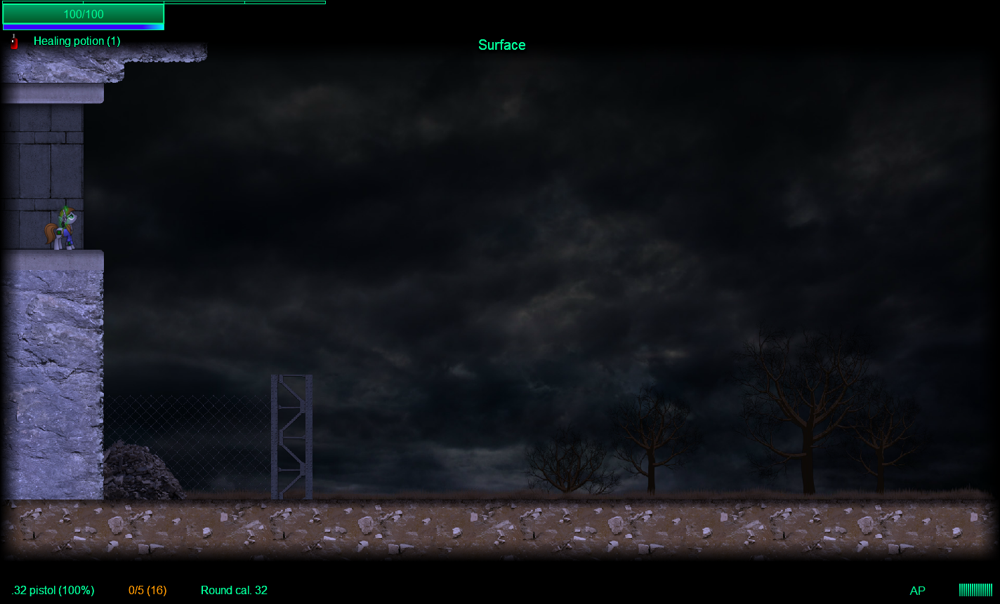
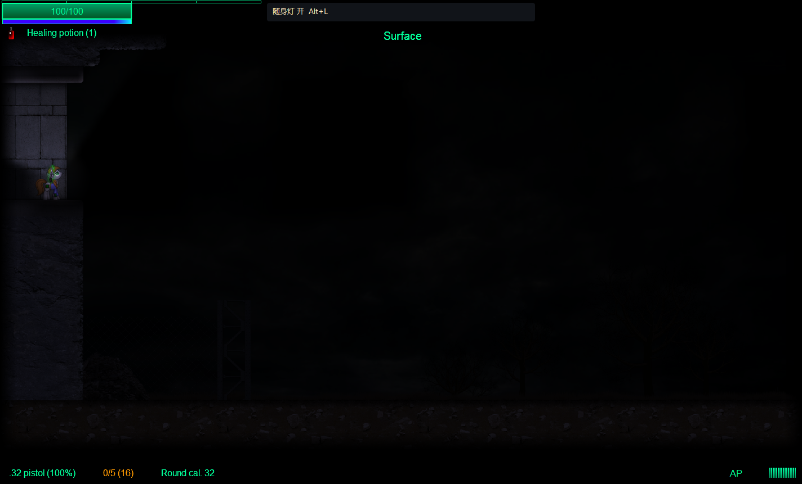

# 地图布灯与整体偏暗调查

2026-10-19。调查对象为原版 1.02 地图设计、当前安装地图，以及正式 LightAndDarkness 0.3.1（514A）。本轮没有调整生产效果或部署。

**结论：你的体验判断成立。原版地图没有按“所有可读区域必须由实体灯照亮”来设计，而当前模组采用了这种假设。问题由环境亮度过低、室外判断错误、原版布灯稀疏和多重减光共同造成。只补几类发光物，或只关掉随机黑暗区，都不足以解决。**

## 调查覆盖与口径

- 从原版 `GameData.d.land` 的 31 个地区定义追到 29 个独立房间池；军事基地/地堡共用一池，避难厩π/遇袭共用一池，汇总不重复计数。
- 原版公共反编译参考内嵌 **639 个模板**；当前安装的外置 `Rooms/*.xml` 为 **658 个模板**。分开统计，不把当前安装内容直接等同于原始参考。
- 实际运行当前宿主，确认 `roomsLoad=1`，31 个已载入地区的模板数全部与外置统计吻合。根目录 `rooms.xml`、`Rooms/rooms2.xml`、`z_shablon.xml` 没有被这 31 个正式地区引用，未混入分母。
- 十类灯指 `light1–7` 与 `stlight1/3/4`。另计窗户、彩光、招牌、出口光、物体揭幕标记；阴影不算光源。
- 对当前正式模组做 5 个实际场景采样和逐场开关截图，使用独立副本、唯一 AIR 身份、后台桌面；没有读取或修改玩家真实存档。

统计是**模板清点**，不是随机生成后的出现概率、游玩时长或可达面积比例。特殊房、隐藏房、布景模板均保留；没有凭等权模板推算玩家遇到概率。

完整可复算数据：[原版统计](../knowledge/evidence/map-lighting-2026-10-19/reference-census.json)、[安装统计](../knowledge/evidence/map-lighting-2026-10-19/census.json)、[地区 CSV](../knowledge/evidence/map-lighting-2026-10-19/reference-by-region.csv)。脚本：[survey-map-lighting.py](../tools/survey-map-lighting.py)。

## 1. 原版究竟布了多少灯

| 项目 | 原版参考 | 当前安装 |
|---|---:|---:|
| 独立模板 | 639 | 658 |
| 十类灯实例 | 3,605 | 3,677 |
| 完全无灯的模板 | 198（31.0%） | 201（30.5%） |
| 只有 1–2 盏灯的模板 | 117（18.3%） | 123（18.7%） |
| 无灯或仅 1–2 灯，合计 | 315（49.3%） | 324（49.2%） |
| 窗户装饰 | 1,065，分布于 188 个模板 | 1,127，分布于 200 个模板 |
| 其他正向布景光 | 94，分布于 52 个模板 | 95，分布于 53 个模板 |

因此不宜把“多数地方偏暗”简单表述为“多数房间一盏灯也没有”：完全无灯约三成，但接近一半模板至多两盏；灯也高度集中于军事、英克雷和避难厩区域。即使有灯，其数量和位置也未必覆盖主要地面。

下表均为**原版参考**，区域名保留文件标识以便复查。最后一列只是“所有灯全亮、无墙、无衰减”的圆形范围估算，基于灯具定义的名义中心和模组半径；分母为原始网格中的非实体格，包含不可达空腔，不等于真实照明或可行走覆盖。它用于判断稀疏程度，不能当作实测亮度。

| 房间池 | 模板 | 无灯 | 灯具总数 | 理想圆形范围/非实体格 |
|---|---:|---:|---:|---:|
| begin 开局 | 20 | 9 | 40 | 20.3% |
| surf 地表 | 20 | 17 | 3 | 1.6% |
| rbl 营地 | 4 | 1 | 28 | 46.1% |
| plant 工厂 | 55 | 10 | 286 | 44.8% |
| nio | 17 | 3 | 84 | 41.4% |
| sewer 下水道 | 23 | 3 | 75 | 34.7% |
| raiders 掠夺者 | 23 | 11 | 44 | 18.5% |
| stable 避难厩 | 46 | 3 | 381 | 67.0% |
| core | 9 | 1 | 52 | 45.3% |
| garages 车库 | 2 | 1 | 2 | 12.1% |
| mane 马哈顿废墟 | 59 | 25 | 111 | 21.5% |
| mtn 神秘科学部高塔 | 12 | 10 | 3 | 2.2% |
| way 道路 | 1 | 1 | 0 | 0% |
| covert | 4 | 1 | 8 | 24.8% |
| src | 1 | 0 | 3 | 50.3% |
| canter 坎特洛特 | 49 | 19 | 85 | 19.5% |
| minst 印象部 | 15 | 8 | 49 | 21.6% |
| mbase 基地/地堡 | 31 | 2 | 658 | 46.0% |
| workshop 工坊 | 17 | 9 | 57 | 25.6% |
| hql 军团总部 | 14 | 9 | 31 | 18.1% |
| post | 3 | 1 | 9 | 16.4% |
| encl 英克雷 | 23 | 0 | 528 | 62.7% |
| comm | 5 | 1 | 62 | 54.0% |
| art | 29 | 6 | 295 | 39.1% |
| pi 避难厩π | 46 | 2 | 412 | 71.7% |
| pis | 20 | 10 | 22 | 12.0% |
| thunder | 7 | 3 | 40 | 25.2% |
| grave 墓地 | 3 | 3 | 0 | 0% |
| prob 特殊挑战池 | 81 | 29 | 237 | 24.8% |

安装数据增加了 mane 6 个、canter 10 个、stable 3 个模板，共 19 个、72 盏灯。按忽略排列顺序的“灯具属性＋房间选项”比较，639 个原版模板中有 636 份对应签名仍在安装池中；本调查没有追查其余差异由哪个编辑器或模组产生。

## 2. 最直接的错误：把飞行场景当室外识别

当前 `LadRuntime.render` 使用：

```as3
location.sky ? Math.max(0.6, ambient) : ambient
```

`LadAtmosphere.zones` 又用 `!loc.sky` 决定是否生成室内黑暗斑块。

但是原版 `Location.sky` 来自房间 `<options sky=...>`，其使用者会强制玩家飞行、改变相机档位和弹丸/攻击处理。它是**特殊空战/飞行场景标志**，不能当通用户外分类。

普通露天画面主要由地区/房间的 `backwall="sky"`、远景 `fon`、房间裁切 `backform`、背景洞和窗口共同构成。原版参考中，合并地区默认后有 **83 个模板使用 sky 背景，仅 1 个设置 sky 标志**；其余 82 个仍会被当前模组套用 0.14 底亮度和自动暗区。安装数据对应 85/1/84。

实际地表 `surf/loc0_1`、高塔入口 `mtn/loc0_8` 均测得 `backwall=sky, sky=false`，动态光照按 0.14 计算；后者也有随机黑暗斑块。

不能反过来把 `backwall=sky` 直接当作每个像素都暴露于天空：同房可同时包含建筑内部、露天边缘和洞穴。这个字段适合提供环境分类线索，最终仍应按区域和遮挡细化。屋顶的 `ramka/backform` 路径也必须考虑。[既有原生背景洞证据](../../../shared-knowledge/rendering/discoveries/native-fracture-layers.md)

## 3. 原版可读性不依赖实体灯闭合供光

原版并非一个以灯的总能量决定所有像素亮度的系统：

- `Location.darkness/color` 和 `Grafon.drawLoc` 对背景、装饰、前景做不同的暗度与调色处理；灯晕画入 `colorBmp`，再用 hardlight 合成背景。
- 窗口与背景洞可擦除后墙 alpha，显示远景；这属于布景结构，不会自动成为逐点照度。
- `Tile.visi/visLight` 是探索与视野黑幕。默认已探索区域可以保留可见性；它与“现在有多少照明”不同。
- `Box.light` 是额外揭幕点。原版参考仅 37 个显式标记，分布于 10 个模板；它可能在普通物体上，不能直接当作物理灯具目录。
- `allon/alloff` 会改灯帧、房间调色，还会影响锁与互动。不能为了补光对所有房间调用 `allon()`。

当前模组在这套原画面上增加乘法照度层。未受灯照的地方再乘约 0.14，即使本来是作者安排的可读地表、商店、窗口附近或安全通道，也被统一压暗。原生背景灯转换为动态灯时，旧灯壳/灯晕被移出烘焙，改用新的半径、衰减和墙体遮挡；原版没有保证这些灯的位置足以承担新职责。

## 4. 当前默认设置怎样继续减光

| 因素 | 正式 0.3.1 的处理 | 对偏暗的贡献 |
|---|---|---|
| 普通基础亮度 | 0.14；8位栅格实际为 35/255≈13.7% | 覆盖几乎所有正常地图 |
| 自动暗区 | 560×560 网格，哈希选择约38%；每块440×440、柔边110、底亮度系数0.08 | 与灯密度、道路、基地、任务位置无关 |
| 暗区中心 | `int(35×0.08)=2`，即2/255≈0.8% | 极易接近纯黑；灯仍能照亮，不是吞掉全部灯光 |
| 灯初始开关 | 只把 `bo.frame==frameOn` 视为开启 | 原版随机素材帧变成照明可用性 |
| 灯亮度 | 确定性分配0.35/0.65/1三档 | 约三分之二不处于满亮档，且不按场景用途区别 |
| 故障样式 | 哈希分布约68%稳定、14%慢、10%快、8%成串闪断 | 稀疏布灯房间也可能失去唯一可靠亮点 |
| 灯半径 | 190–390像素，即4.75–9.75格 | 标准房间48×25格；墙门和衰减进一步缩小有效范围 |
| 随身灯 | 440像素定向光＋85像素近身漫光 | 能帮助局部行动，不能补足全图环境可读性 |

原版 `BackObj` 在没有强制通电/断电或固定帧时随机选素材帧。两帧灯在当前识别下约1/2开启，三帧灯约1/3。以模板初始条件及π家园通电规则计算，3,605盏中3,022盏走随机帧；预计开启数约1,895（52.6%）。这是初始状态模型，不是玩家存档实测；剧情、手动开灯、已保存开关会改变它。

0.14不是物理照度或人眼亮度百分比，而是颜色乘法层的通道值；已经暗的原画再乘这个值会更难辨认。战斗侧也会受到影响：普通玩家视觉暴露乘 `0.18+0.82×照度`，在35/255处约为原基值的29.3%，在2/255处约18.6%。所以补光后也需要检查潜行节奏，不能只看截图；听觉、开火暴露和AI记忆是另一路径。

## 5. 实际场景对照

直接加载正式 **514A** 模组，宿主为本轮冻结的 **2A466248…FFB3EA**。本轮只启用 LAD 与调查探针，loader 的本轮 requested/ok 均恰好为这两个入口，无 err；31个地区成功载入。没有把生产14模组清单等同于已验证的运行组合。

采样点为“格子本身和上一格为空、下一格为实体”的地面邻近点；不做导航可达性认证。下表使用**关闭随身灯后的固定场景光**，避免玩家朝向改变全图指标。照度来自正式 `LadLightField` 同一算法，取 RGB 最大通道；不是屏幕平均像素亮度。一次新档的灯帧与随机房间结果不能外推所有存档。

| 实际场景 | 灯数/开启 | 地面采样点 | 低于20%照度 | 照度中位数 | 自动暗区 |
|---|---:|---:|---:|---:|---:|
| 营地 rbl/loc0_0 | 9 / 8 | 116 | 70（60.3%） | 13.7% | 1 |
| 地表 surf/loc0_1 | 0 / 0 | 46 | 46（100%） | 13.7% | 3 |
| 马哈顿 random_mane/loc0_4 | 0 / 0 | 99 | 99（100%） | 13.7% | 1 |
| 高塔入口 mtn/loc0_8 | 0 / 0 | 46 | 46（100%） | 13.7% | 2 |
| 避难厩π stable_pi/loc3_5 | 14 / 14 | 141 | 63（44.7%） | 30.2% | 1 |

关闭自动暗区后，无灯的三间仍有100%采样点低于20%；营地仍为60.3%；π入口从44.7%变为44.0%。**暗区是加重因素，基础照明不足才是大范围偏暗的主要原因。** π入口即使14灯全开，仍有很暗的上层和边角，说明不能把问题全部归于随机熄灯。

截图在同一暂停场景显式揭开原生探索黑幕，以单独观察照明；没有改地形或灯的位置。随身灯截图保持探针默认鼠标位置，未模拟玩家主动瞄准，不能用来评价手电的最佳覆盖。五场景共15张原始截图见[运行证据目录](../knowledge/evidence/map-lighting-2026-10-19/runtime/)。

地表，关闭模组：



同一地表，开启模组和随身灯：



营地对照：[原生显示](../knowledge/evidence/map-lighting-2026-10-19/runtime/sample-1-native.png) / [当前模组](../knowledge/evidence/map-lighting-2026-10-19/runtime/sample-1-lad-headlamp.png)。π入口：[原生显示](../knowledge/evidence/map-lighting-2026-10-19/runtime/sample-5-native.png) / [仅场景灯](../knowledge/evidence/map-lighting-2026-10-19/runtime/sample-5-lad-fixed.png)。

## 6. 哪些可以补光，哪些不能一概当灯

| 原版线索 | 已调查规模/机制 | 合理用途 |
|---|---|---|
| 天空背景、远景、屋顶开口 | 83个sky背景模板；还有backform裁切与背景洞 | 分区环境光、外部漫射光；优先解决地表误暗 |
| 外墙窗户 | f/b/s/c/awindow与enclwindow共868个参考实例 | 结合地区与背后环境判断透入的面光 |
| 避难厩窗口 | stwindow及stwindow2共197个 | 可能是内部观察窗；不能自动等同日光入口 |
| 彩光、招牌、出口 | 91彩光＋1招牌＋2出口，共94个 | 环境光/引导光；通常不建立可维修灯壳 |
| 屏幕、终端、机器、火焰 | 主要是自身材质或特效发亮 | 小范围有动机的微光；无法替代整片地表环境光 |
| Box.light | 37显式标记 | 保留原生揭幕语义，不凭名字转成通用光源 |
| shadow | 负向布景阴影 | 排除正光源列表 |

原版198个无灯模板中，182个也没有上述94个布景光。这意味着接入全部彩光/招牌仍无法独力解决多数无灯房间。窗口和环境分类的优先级更高。

大场景还要处理区域混合：当前 ContinuousScene 场景提供 `sceneRegions.region` 的位置、尺寸、backwall/color/dark 等接口。照明应读取局部区域，而不是给整张拼接地图只选一个室内/室外值。本轮只读核对接口，未验证所有大场景生成模式；也没有修改该模组。

## 7. 建议调整顺序

以下为调查后的建议，**尚未实施，也不是已验证的最终数值**。

1. **先重建环境光分类。** 将普通地表、屋顶、室内、地下、据点和剧情暗区区分开；以原版地区、房间选项和局部背景为证据。`sky`只保留其特殊飞行含义。大场景采用分区计算。
2. **保证环境本身可读，再让灯制造差异。** 可先试室外0.60–0.80、安全据点0.45–0.65、普通室内0.28–0.45；明确废弃地下或剧情暗区再试0.06–0.18。它们是乘法层起点，需用各类原画面校准，不能直接当物理亮度。
3. **补充有来源的环境光。** 先做天空/窗洞，再接彩光、招牌和出口引导；机器微光作为近距离细节。窗光和灯仍受真实墙门约束，不能从封闭观察窗无条件照入“日光”。
4. **按场景安排故障和黑暗。** 据点、主通路默认更可靠；废弃区域允许故障。黑暗区选择有掩体、封闭、供电中断等含义的位置，避开出生点、商店与重要交互。保留可被手电/弹丸照亮的规则。
5. **最后补缺灯与调半径。** 当可读性仍不足时，在已有梁、灯座、门廊等位置生成少量可破坏/维修灯；稳定身份并保存，不随镜头或进图随机改位置。先试区域策略，再决定是否需要人工逐图布灯。
6. **同步校准战术效果。** 补光后检查普通视觉发现和潜行掩护，保持噪声、开火暴露、AI记忆；用“亮区—半暗通路—明确暗区”的差异支持战术与探索，不靠大部分地图接近黑色来形成压力。

仅把全局底亮度调高，能快速缓解但会削平真正暗区；仅提高灯倍率照不到无灯区域；仅关闪烁/暗区也无法解决本次三个无灯场景。推荐采用前四步作为同一轮改进，再决定新增灯具规模。

建议验收样本沿用本次五场景，再加入开局地下、工厂、下水道、坎特洛特、英克雷和混合大场景；同时检查灯关闭/损坏/修复、读档、窗光与墙门、手电和弹丸光。用固定地面路径的明暗分布与原始截图判断，不只检查loaded日志。

## 证据、复现与限制

- 原版源码：`fe.loc.LandLoader`（外置/内嵌来源）、`fe.GameData`（31地区与默认环境）、`fe.rooms.Rooms*`（639模板）、`fe.graph.BackObj`（灯帧随机/强制）、`fe.loc.Location.buildLoc/colorFilter/allon/alloff/lightAll`、`fe.graph.Grafon.drawLoc/setLight`、`fe.loc.Land.gotoLoc`、`fe.unit.UnitPlayer`（sky飞行含义）。均位于公共只读1.02参考。
- 模组行为对应生产提交 `a2d28af` 的 `LadRuntime.render/simulationStep`、`LadAtmosphere.style/zones/power`、`LadLampCatalog.discover`、`LadLightField.ambientBackground/traceRay`。并行微光候选未用于本次结论。
- 运行回执：[survey.json](../knowledge/evidence/map-lighting-2026-10-19/runtime/survey.json)、[选择记录](../knowledge/evidence/map-lighting-2026-10-19/runtime/selection.json)、[冻结指纹](../knowledge/evidence/map-lighting-2026-10-19/runtime/hashes.json)、[正式模组运行日志](../knowledge/evidence/map-lighting-2026-10-19/runtime/lad-runtime.log.txt)。独立应用 `remains-lad-survey-20261019171033934493`，运行后退出，进程句柄/桌面已关闭。
- 全量扫描覆盖全部注册原版模板，但只实际进入5个场景；没有声称逐房游玩、所有随机种子、全部敌种或联机认证。当前14模组组合、RealisticVision的额外视野遮罩、ContinuousScene最新生成玩法和GPU前台画面未作本轮整体认证。
- 首次运行驱动在旅行过渡未完成时发起下一次旅行，被原版 `World.exitLand` 的 `t_exit>0` 返回阻止；其超时结果不计入有效样本。加入过渡结束门控后使用新应用ID重测，最终5场景完成。后台桌面首次在受限权限下创建失败，后经正常权限流程运行；没有退到用户前台桌面。
- 本轮没有修改正式SWF、模组配置、原始地图或真实存档。修改范围为调查脚本、证据、报告和记忆记录。
