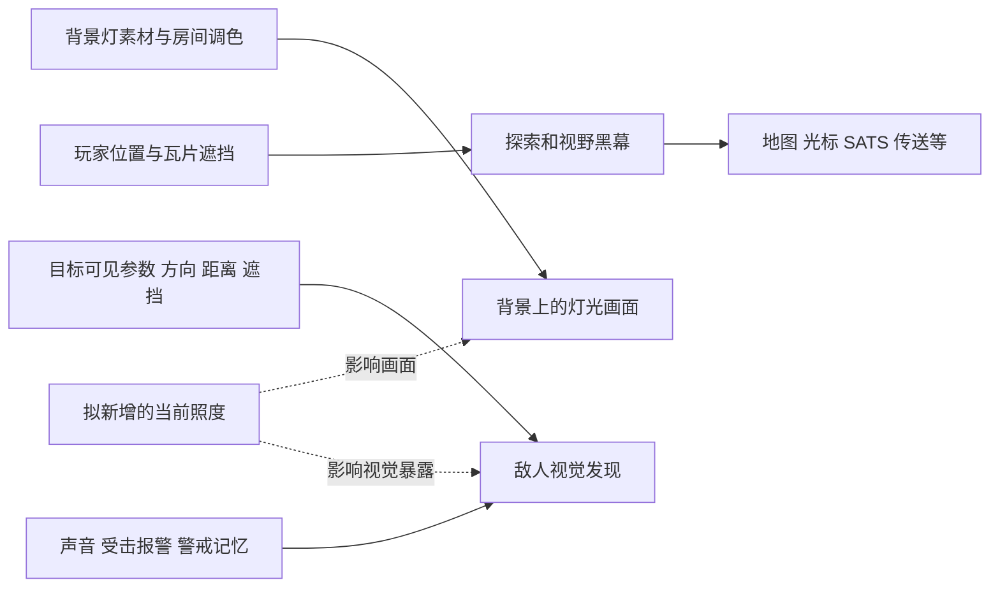

# Remains 原版光源与光照系统调查

2026-10-15，面向 LightAndDarkness。结论以 1.02 反编译源码与本地纹理资源结构为依据。**原版有灯光表现、探索黑幕和敌人感知，但没有把它们统一起来的通用照明系统。** 新模组的主要工作是补齐这个联系，并为背景灯加入损坏、维修和持久化。

## 调查范围与证据

实际启动描述符 `application.xml` 指向根 `pfe.swf`。源码来源是公共只读 `game-reference/decompiled/1.02/src102/scripts`，没有把 1.03/1.04 的零散资料套进来。

本轮开始核对的正式宿主 SHA-256 是 `BEBEEA8B3F40A7DB3E7B1BE6F3530D5AF9EA7A3299DECB164BF0DAE107D4011F`。公共登记证明宿主已有 ContinuousScene 对 Grafon 的扩展，故本报告不能证明当前正式宿主逐方法等于原版参考。当前文件指纹也不等于已完成字节码核对。

详尽证据与行号在三个专题中：

| 专题 | 覆盖内容 | 原始证据类型 |
|---|---|---|
| [渲染与可见度](../knowledge/discoveries/rendering-audit.md) | 环境亮暗、烘焙灯光、遮挡传播、图层、更新与性能、公开接口 | 1.02 源码、共享冲突记录 |
| [灯具装备与维修](../knowledge/discoveries/fixtures-audit.md) | 灯具目录、纹理符号与帧数、装备命名纠错、命中/维修/保存 | 1.02 源码、本地 texture1.swf 标签 |
| [战斗与感知](../knowledge/discoveries/combat-audit.md) | 视觉/听觉、暴露、敌种差异、红外、SATS、接入时序 | 1.02 源码、已有感知审计复核 |

没有启动游戏、操作用户存档或部署产物。跨区经验检索有一份非本主题来源不可读；无命中不代表没有相关经验。改用较宽的 Remains 查询后，已回读 KB-000056 r1 的性能验证方法，未越界进入其来源模组。

## 原版实际存在的几套机制

| 名称 | 输入和作用 | 不应误解为 |
|---|---|---|
| 环境亮暗与调色 | `Location.darkness/color/cTransform` 调整房间颜色、背景混合 | 每个角色位置的真实照度 |
| 背景灯晕 | `BackObj.light` 的 `_l` 图形进入 `colorBmp`，以 hardlight 混入背景 | 会自动挡墙、照亮角色或让 AI 看见目标的光源 |
| 探索黑幕 | `Tile.t_visi/visi` 经 `lightBmp/visLight` 覆盖世界 | 可以随意改写的单纯亮度贴图 |
| 提前揭幕标记 | `loc.objs` 中 `light=true` 的物体在进房时调用 `lighting` | 所有灯具/发光敌人的统一清单 |
| 特效发亮 | 僵尸光晕、粒子、枪口闪光用混合模式/滤镜显示 | 持续改变周围照度的动态灯 |
| 战斗感知 | 视觉距离、方向、墙体、噪声、潜行、警戒与目标记忆 | 从画面像素明暗自动获得潜行效果 |

简化关系图：

虚线为拟议联系，原版没有这套统一照度服务。

## 黑幕算法与真正黑暗区的差距

参考普通房间是 48×25 格，每格 40 像素。黑幕采用约一格一个像素的低分辨率图，放大并平滑覆盖世界。默认玩家全亮半径 300、截止半径 1000，再受房间 `visMult` 缩放。

`Location.lighting` 对格子算距离衰减，然后沿格子射线逐次减去 `Tile.opac`；水可额外扣可见度。门开关和破墙改变格子遮挡。背景灯晕的烘焙路径没有进行这套遮挡计算；前景投到背景的固定方向阴影也不是逐灯实时阴影。

默认 `retDark=false` 会保留已照亮区域。开启回暗后，算法逐次追向当前光心的结果；逐灯调用会互相压暗，无法直接变成稳定多灯叠加。原版没有按每盏灯保存贡献，故灭一盏灯也没有对应的“减掉这盏灯”操作。

`Tile.visi` 还用于地图透明度、光标对象、部分 SATS 目标、传送、宠物与噪声提示。建议保留这些原生意义，独立计算“现在有多亮”。仅缩小探索半径、把整个房间调黑或重写 `visi`，都不能直接完成用户要的战术光暗。

## 灯具与其他光源清单

原版数据中十类背景灯是 `light1`、`stlight1`、`light2`、`light3`、`stlight3`、`light4`、`stlight4`、`light5`、`light6`、`light7`，包括圆灯、条形灯、吊灯、红指示灯和不同场景灯。完整开关帧、尺寸与素材表见灯具专题。

本地 `texture1.swf` 有 14 个 `back_*_l` 导出符号：十类灯，再加酒吧招牌、出口光、彩光与阴影。**带 `_l` 的资源不一定是可破坏的正光源**。彩光有十种颜色共享纹理；出口光应优先保留为引导；阴影不应被当成发光灯。

原版 `BackObj.onoff` 只切素材帧。灯晕已画入背景，必须重新合成相应背景才会实际消失。资源帧还存在需视觉核对的边界：红指示灯没有标准开关帧定义，酒吧招牌的数据定义关灯第 2 帧，但本地素材只有 1 帧。标签结构不是“关灯画面已验证”。

原版 `lamp` 是坏台灯杂物，且有相关收集任务；`lighter` 是制作组件；`PipBuck.light` 是简化界面模式。它们都不能直接当成已实现的装备手电。原版视觉增强药剂提供红外效果并影响特定隐身敌人，不能随手当灯开关复用。

发光僵尸的局部光晕、枪口火花和发光弹体主要是显示效果；幽灵显示命令存在一次揭幕调用，但不构成通用移动灯系统。让火焰、枪火、敌人灯具实际照亮周围是可扩展的新能力。

## 破坏与修复需要补什么

背景灯不是原生可攻击实体：没有 HP、碰撞、互动、存档码，子弹也不遍历 `backobjs`。直接给背景对象想象一个 hp 属性不能令子弹命中它。

可调查的接入包括独立命中代理，以及 `Box/VirtualUnit` 的既有路径。普通 Box 也不是所有攻击都能命中的靶子；玩家拆除、敌弹、爆炸与地形破坏各有分支。灯壳命中范围应与实际灯壳接近，光晕不能当碰撞体，背景灯也不应成为挡路的实体墙。

原生发电机维修提供了技能门槛、进度交互和完成回调。其样例最终调用全房通电，而全房 `allon` 除了改变色调与灯帧，还激活互动并解除 `lockTip==4` 的锁。模组修单灯应调用自己的状态逻辑。

`Interact.cons` 只能原生消费一种材料一个单位，并在完成回调前扣除。多材料配方、回调失败退款、打断与读档一致性要由模组另做；原生发电机样例本身没有设置耗材。可继承维修交互体验，不能把它当已经具备材料事务的修灯系统。

背景灯没有逐灯保存入口；`Box.save` 也不保存当前 HP 和 light。新模组须为开关、损坏、供电、维修保存稳定状态，并让新游戏、角色读档、死亡回档、随机房重建互不污染。

## 明暗现在怎样影响战斗

普通视觉距离核心是：

`R = (目标 visibility × stealthMult × 房间 visMult + demask) × 观察者 vision`

再经过朝向、视线角度和实体瓦片遮挡。玩家还有共享暴露累计、潜行技能对抗、蹲伏与藏身抵消。房间 `visMult` 可以同时影响探索距离和发现距离，但它是房间级参数，不是灯照到当前位置的结果。

**原版关灯并不自动改变这条公式。** `allon/alloff` 没有按灯的状态修改视觉暴露。仅让画面更黑，可能变成玩家看不清而敌人照常发现玩家。

听觉是另一条通道，枪口 shine→demask 又是独立暴露来源；受击、死亡和同伴报警还会传播警戒。黑暗方案应减少视觉获取信息，而不自动清除噪声、仇恨与最后位置。已锁定敌人的跟踪行为也必须单独处理。

特殊敌人不能一套参数全覆盖：炮塔的绝对可视分支、地狱犬近距离探测、天角兽/斑马隐身、部分 Boss 警戒与目标逻辑，详见战斗专题。原生红外也不只是画面滤镜，可能改变隐身相关闪避和显形。

## 接入可行性与主要风险

| 工作 | 源码支持 | 待验证边界 |
|---|---|---|
| 读场景灯位置/帧 | 公开 `backobjs` 与 BackObj 字段 | 实际灯帧、bounds、剧情覆盖 |
| 独立光照层与照度 | 公开显示容器、格子遮挡数据 | 层序、半透明材质、多灯、性能 |
| 影响普通敌人视觉 | 原生 visibility 参与发现 | 普通帧后改写会被 actions 覆盖；childObjs 时序候选需实测 |
| 破坏灯具 | Box/VirtualUnit 等可作命中接入候选 | 各攻击类型、来源、复活与误碰撞 |
| 维修灯具 | Interact 门槛/进度/回调 | 材料原子扣除、打断、回调失败 |
| 跨房/读档保存 | 可自建版本化状态 | 稳定灯身份、存档槽/死亡回档一致性 |
| 大场景与混装 | 公共登记有分块/图层资料 | 当前宿主扩展、RV/WB/TDFC 等实际组合 |

模组载入域不能任意替换原生类方法，也不能把 internal/private 当成普通 public。公开参数适配与同包桥接有适用边界，不应先承诺零补丁实现全部敌人行为。

尤其要验证：`Location.step` 先更新玩家再更新敌人；玩家 actions 每步重设 visibility；玩家 `childObjs` 在 actions 之后执行。附属对象更新可作为候选时点，避开普通帧后赋值被覆盖的问题，但必须处理固定槽位、死亡、重建和显示清理。

## 当前安装与后续建议

当前 `mods/loader-manifest.txt` 已包含 12 个条目，根版启用 11 个，其中包括 RV、WallBlend、ContinuousScene、TDFC、Sandevistan、RConnect。独立 ModSettings 被禁用，公共登记指向 ModLoader 内的设置服务。根指引的六模组和专属 loader 清单是历史摘要，不能直接用来规划新入口。

本次没有新 SWF、清单条目、热键、日志或存储资源占用；项目只是调查与设计阶段。未来产物名可采用 `LightAndDarknessMod.swf`，通过现有加载体系接入，不能把“新模组”自动等同于“要再给 MainFE 打专属 loader”。

推荐优先验证：**一间房、两盏固定灯、一盏随身灯、一个普通敌人；先证明光照与视觉发现一致，且声音仍有效，再接电量、破坏、维修和保存。** 完整玩法比较与阶段验收见[战术光暗与生存探索草案](vision-and-options.md)。

## 尚未覆盖的边界

- 当前正式宿主新增方法与原版逐方法对照、实际视觉与耗时尚未测量。
- 全部地图的灯具实例数量未完成：批量只读计数被保护钩子拒绝；十类定义及实际纹理符号已核对。
- 纹理各帧的像素内容、所有武器与敌种、联机同步没有实测，DLC 1.03/1.04 没有宣称兼容。
- `AGENT_SCOPE.md` 新建被 protected-governance 钩子拒绝，未通过另一工具绕过。项目参数和阶段暂由 README 与 state/MEMORY 接续；这不是已完成完整新模组初始化或部署。
