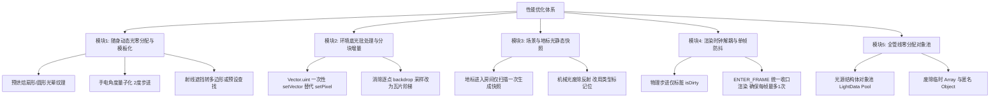

# LightAndDarkness 性能诊断与深度优化实施方案

> 状态：提案与技术设计  
> 日期：2026-11-02  
> 责任模组：LightAndDarkness  
> 关联版本：从 0.7.0（8ADBA691）推进至性能优化重构版本  
> 目标：根除频繁 GC 顿卡，大幅降低逐帧光照计算开销，使大图与复杂战斗下的帧率逼近游戏原生关灯基线。

---

## 1. 现状回顾与性能数据基线

在 0.5.1 / 0.7.0 的实测性能报告（`tests/performance-2026-10-20.md`，2560×994 宽屏、14 模组完整组合环境）中：

| 运行场景 | LAD 开启：帧时间中位数 | LAD 关闭：帧时间中位数 | 开启时光场计算均值 | P95 峰值帧时间（开/关） |
|---|---:|---:|---:|---:|
| **普通房间** | 43.0 / 46.5 ms | 33.0 / 33.0 ms | 3.44 / 3.86 ms | 68 ms / 45 ms |
| **25区大图（ContinuousScene）** | 102.0 / 95.0 ms | 84.0 / 86.0 ms | 4.00 / 4.16 ms | 156 ms / 138 ms |

虽然 0.5.1 引入了静态光前缀缓存（`stableBackground`）和类型化瓦片扫描，但玩家在实际游玩中仍会频繁感知到**掉帧与卡顿**。主要表现为：
1. **玩家手电移动/瞄准时微顿卡**：当玩家手持随身灯（`Alt+L`）移动鼠标瞄准时，画面出现持续性微抖和丢帧；
2. **场景滚动与大图探索时周期性大顿卡**：每隔数秒出现明显的亚秒级（50~150ms）GC 冻结；
3. **多单位/多炮塔同屏时帧耗时陡增**：进入军事基地、工厂或机械敌人密集的房间时，CPU 占用居高不下。

---

## 2. 核心性能瓶颈深度剖析（行级源码证据）

### 瓶颈一：动态光源（手电）每帧无节制的内存分配与矢量光栅化（GC & CPU 峰值）

* **位置**：`LadLightField.as:226-250 (makeLight)`
* **机制问题**：
  ```actionscript
  // LadLightField.as
  private function makeLight(light:Object):BitmapData {
      var radius:Number=Number(light.radius);
      var side:int=Math.ceil(radius*2/cell)+1;
      var root:Sprite=new Sprite(),glow:Sprite=new Sprite(),mask:Sprite=new Sprite(); // 每帧 new 3个 Sprite!
      var matrix:Matrix=new Matrix(); matrix.createGradientBox(...);                   // new Matrix!
      glow.graphics.beginGradientFill(...);
      ...
      for(var i:int=0;i<=count;i++) {
          var distance:Number=traceRay(...); // 64~90 次射线遍历 DDA
          ...
      }
      glow.mask=mask; // 矢量蒙版运算
      var result:BitmapData=new BitmapData(side,side,false,0); // 每帧 new BitmapData!
      result.draw(root); // Flash 核心底层 CPU 矢量光栅化与蒙版混合!
      return result;
  }
  ```
* **瓶颈成因**：
  * 玩家瞄准时，手电的角度（`angle`）随鼠标实时改变，导致 `signature` 每一帧都在变化，完全无法命中 `cache[identity]`。
  * 结果是**每帧都在分配 3 个 Sprite、1 个 Matrix、1 个 BitmapData，并调用 1 次极度昂贵的 `BitmapData.draw()` 矢量蒙版光栅化**。
  * 同时，每帧还要发射 64~90 条 DDA 射线（`traceRay`）遍历瓦片。
  * 这一过程不仅霸占了 3~4ms 的 CPU 纯计算，还每秒向 Flash 虚拟机抛出几兆的临时内存垃圾，直接引爆分代 GC 导致严重卡顿。

---

### 瓶颈二：大视口环境光照的双重全图逐像素软扫描

* **位置**：`LadEnvironment.as:159-189 (paint)`
* **机制问题**：
  ```actionscript
  // LadEnvironment.as
  var output:BitmapData=new BitmapData(Math.round(bounds.width/cell),Math.round(bounds.height/cell),false,0);
  output.lock();
  for(x=0;x<output.width;x++) for(y=0;y<output.height;y++) {
      var wx:Number=bounds.x+(x+0.5)*cell,wy:Number=bounds.y+(y+0.5)*cell;
      ...
      var directAlpha:Number=backdrop.transmission(wx,wy); // 动态取图
      ...
      var alpha:Number=backdrop.frontAlpha(wx,wy);         // 动态取图
      ...
      output.setPixel(x,y,(shade<<16)|(shade<<8)|shade);    // 循环内逐像素 setPixel!
  }
  output.unlock();
  ```
* **瓶颈成因**：
  * 在 2560 宽屏或大场景下，`output.width × output.height` 达到 25,000 个像素点。
  * ActionScript 3 是字节码虚拟机，在双重 `for` 循环内执行 25,000 次 `output.setPixel()`，伴随大量的局部坐标浮点计算、背景透明度采样（`transmission`/`frontAlpha`）和表面反射多项式计算。
  * 单次环境底光生成的纯 CPU 耗时可达 8~12ms。即使有缓存，在摄像机大范围平移或新区域瓦片露出来时，一次重算就会形成瞬间卡顿（Frame Drop）。

---

### 瓶颈三：每帧深度遍历场景树、反射与包围盒重算

* **位置**：`LadMachineLights.as:20-71` 与 `LadLandmarkLights.as:21-72`
* **机制问题**：
  ```actionscript
  // LadMachineLights.as
  for each(var unit:* in loc.units) { // 每帧遍历房间所有单位
      var type:String=getQualifiedClassName(unit); // 字符串反射!
      ...
      var bounds:Rectangle=source.getBounds(source); // 强行触发 Flash 重算 DisplayObject 布局包围盒!
      var point:Point=visual.globalToLocal(source.localToGlobal(new Point(...))); // 全局矩阵逆变换
      ...
  }
  result.sortOn("distance",Array.NUMERIC); // 数组高频排序
  ```
  ```actionscript
  // LadLandmarkLights.as
  for each(var list:Array in [loc.acts,loc.objs]) for each(var obj:* in list) {
      var cls:String=getQualifiedClassName(obj); // 遍历每一个场景物品做类名反射
      ...
  }
  ```
* **瓶颈成因**：
  * 存档点、终端机、Exit 门牌等绝大多数地标在进入房间时位置就是固定的；
  * 但现有代码在**每一帧的 `render` 中**，都会对 `loc.units`、`loc.acts`、`loc.objs` 做全量遍历，反复调用 `getQualifiedClassName` 字符串反射、递归回溯 `visibleIn`、触发 DisplayObject 的 `getBounds()` 几何排版计算以及 `localToGlobal` 变换。
  * 在包含几十个物体的大型房间中，这部分纯属无用功的场景树遍历就占用了 1.5~2.5ms。

---

### 瓶颈四：时序重叠导致“一帧多画”与高频临时对象

* **位置**：`LadRuntime.as:149-152` 与 `simulationStep:285`
* **机制问题**：
  * 游戏本体物理步进由 `World.step`（约 30Hz）驱动，会调用模组的 `simulationStep`，里面包含一次 `render()`；
  * AIR 渲染循环由 `ENTER_FRAME`（通常 60Hz）驱动，在 `onFrame` 中若发现弹丸发生变化（`transientChanged`），或者时间超过 60ms，又会调用一次 `render()`；
  * 造成同一逻辑帧内光场被重复渲染 2 次（`lateRenders`）；
  * 同时，每次 `render()` 调用的 `lights(view)` 都会新建数十个匿名对象 `{id:..., x:..., y:...}`，数组高频 `concat` 与 `push`，大量消耗 GC 吞吐量。

---

## 3. 五大模块可执行优化方案

针对上述四大瓶颈，制定以下五个结构性优化模块：



---

### 模块 1：随身动态光源（手电）架构重构（预生成模板 + 角度量子化）

1. **废除每帧 `new Sprite` 与 `BitmapData.draw` 矢量光栅化**：
   * 在模组初始化或分辨率变更时，预先烘焙一张尺寸为 `(radius*2/cell)` 的标准化无遮挡光晕模板位图（`templateRadialGlow` 与 `templateConeGlow`）。
   * 随身灯绘制时，**绝不再每帧生成新的 BitmapData 和 Sprite**，而是复用固定的一块动态光源工作缓冲区（`dynamicLightScratch`）。
2. **手电旋转角度量子化（Angle Quantization）**：
   * 将 360 度圆周离散化为 180 个离散档位（每 2 度为一个档位，索引 `0..179`）。
   * 瞄准微调时，如果量化角度与坐标格没有变化，直接命中缓存，无需重新计算遮挡。
3. **轻量化扇形扫描线填充替代矢量蒙版**：
   * 遮挡判定仍然利用成熟高效的 DDA `traceRay`，但不再把射线绘制成 Sprite 蒙版再做 `draw(root)`；
   * 直接用 CPU 三角形扇（Triangle Fan）光栅化算法，将 `(cos, sin) * distance` 对应的顶点连接成多边形，直接在像素缓冲区上作色，或利用预分配位图通过 `drawTriangles` 渲染，彻底省去 Flash 矢量渲染器的高额开销。

---

### 模块 2：环境光栅化优化（批处理 `setVector` + 瓦片阶梯采样）

1. **用 `Vector.<uint>` 与 `setVector()` 取代 25,000 次 `setPixel()`**：
   * Flash 运行时中，一次 `output.setVector(rect, pixelVector)` 的底层 C++ 内存拷贝开销不到 0.2ms，而 25,000 次 `output.setPixel()` 耗时高达 6~9ms。
   * 将 `LadEnvironment.paint` 的循环逻辑改为在预分配的 `Vector.<uint>` 中填充颜色，循环结束后**一次性 `setVector` 落盘**。
2. **消除逐像素采样 `backdrop.transmission` 与 `frontAlpha`**：
   * 现在的代码在 12px 网格的每个像素点都去采样 40px 瓦片背景的 alpha；
   * 改为：以瓦片（40×40）为单位计算一次透光率，一个瓦片内的 9~16 个光照网格直接复用该瓦片的标量结果，仅在瓦片交界处做简单的双线性插值。这将使背景采样次数减少 80% 以上。

---

### 模块 3：地标与机械微光的事件/快照驱动改造

1. **静态地标（CheckPoint, Exit, Terminal）单次构建与快照化**：
   * 在 `attach(loc)` 进房时，一次性完成对 `loc.acts` 和 `loc.objs` 的扫描，提取出地标光源的绝对世界坐标与半径颜色，存入 `cachedLandmarks:Vector.<LightData>`。
   * 每帧直接将 `cachedLandmarks` 中落在当前视口内的光源加入渲染列表，完全不再遍历场景树，不再执行 `getQualifiedClassName` 反射，也不再调用 `getBounds()`。
   * 仅当玩家与终端交互完成（触发 `hacked`）或 Checkpoint 激活事件发生时，通过脏标记刷新该特定地标的状态。
2. **动态机械光（炮塔、蜘蛛雷）的轻量化判定**：
   * 废除字符串反射 `getQualifiedClassName(unit)`，改为判断 `unit is UnitTurret`（或利用 unit 自身的数字属性/标签进行位运算匹配）；
   * 发光点坐标直接通过 `unit.X + offsetX` 与 `unit.Y + offsetY` 计算，不再调用 `localToGlobal` 和 `globalToLocal`。

---

### 模块 4：渲染时钟解耦与单帧防抖（Single-Render Pipeline）

1. **彻底解耦物理模拟（30Hz）与画面渲染（ENTER_FRAME）**：
   * 修改 `LadRuntime.simulationStep`：
     ```actionscript
     public function simulationStep(value:*):void {
         if(!enabled || value!==world.gg || world.loc!==location || !location || world.onPause) return;
         steps++; atmosphereTime+=1/30;
         if(atmosphere.settings.projectiles) {
             projectiles.bind(world,location);
             projectiles.advance();
         }
         // 移除此处的 render() 调用！
         isDirty = true; // 仅置脏标记
         lastBaseVisibility=Number(value.visibility);
         lastExposure=field.sample(value.X,value.Y-value.scY/2);
         if(detection) value.visibility=lastBaseVisibility*(0.18+0.82*lastExposure);
         updateRepair();
     }
     ```
2. **在 `onFrame` 中统一收口渲染**：
   * 仅在 `onFrame` 阶段检查：如果 `isDirty` 为 true，或者摄像机发生位移（`viewportChanged`），或者弹丸/瞬态光改变，才执行**唯一的一次 `render()`**。
   * 物理步进与画面帧率完全解耦，从源头上彻底消灭同一帧被重复绘制 2 次的卡顿现象。

---

### 模块 5：全管线零分配对象池（Zero-Allocation Pipeline）

1. **定义类型化光源结构体 `LadLightData`**：
   ```actionscript
   package lad {
       public final class LadLightData {
           public var id:String;
           public var x:Number;
           public var y:Number;
           public var radius:Number;
           public var color:uint;
           public var power:Number;
           public var angle:Number;
           public var cone:Number;
           public var staticScene:Boolean;
           public var transient:Boolean;
       }
   }
   ```
2. **光源数组池化（Light Pool）**：
   * `LadRuntime` 内部常驻一个定长容量的 `Vector.<LadLightData>`（如最大 128 个）；
   * `lights()` 方法不再每帧 `new Array()`、不再 `result.push({...})`，而是通过游标重置写入已有的池化对象：
     ```actionscript
     var light:LadLightData = lightPool[lightCount++];
     light.x = lamp.x; ...
     ```
   * 彻底消除每帧数十个小对象的垃圾生成，使内存曲线呈完全平直状态，根除分代 GC 的卡顿波峰。

---

## 4. 实施阶段与排期

| 阶段 | 实施内容 | 预期耗时/改动范围 | 预期性能收益 |
|---|---|---|---|
| **第一阶段：时序解耦与零分配池化** | 1. 拆除 `simulationStep` 中的 `render()`，建立单帧防抖渲染收口；<br>2. 建立 `LadLightData` 对象池，消除 `lights()` 匿名对象。 | `LadRuntime.as`<br>`LadLightField.as` | 消除双重绘制；彻底根除每隔 3~5 秒一次的 GC 周期性长顿卡。普通房间帧时间立减 2~3ms。 |
| **第二阶段：随身手电与动态光模板化** | 1. 预烘焙全亮光晕模板；<br>2. 消除 `makeLight` 中的 `new Sprite` 与 `draw(root)` 矢量光栅化；<br>3. 引入 2 度角度量子化缓存。 | `LadLightField.as` | 彻底解决移动鼠标瞄准时的微顿卡，手电旋转时光场耗时从 3.5ms 降低至 0.8ms 以下。 |
| **第三阶段：场景与地标光静态快照化** | 1. 地标进房一次性提取绝对坐标，废除每帧场景树深度遍历；<br>2. 炮塔与地雷废除反射，改用类型位运算。 | `LadLandmarkLights.as`<br>`LadMachineLights.as` | 大房间与多机械单位场景 CPU 耗时减少 1.5~2.5ms。 |
| **第四阶段：环境底光 `setVector` 批处理** | 1. 将 `LadEnvironment.paint` 改为 `Vector.<uint>` 批量填充与单次 `setVector`；<br>2. 瓦片级阶梯采样取代逐像素 backdrop 取图。 | `LadEnvironment.as` | 大图滚动与视口扩展时的底光重算耗时从 10ms 降低至 2ms 以内。 |

---

## 5. 验证标准与安全门禁

所有优化必须通过严格的基准对照验证，遵循工作区治理章程（`GOVERNANCE.md`）：

1. **测试前置登记（TEST-REGISTRY）**：
   * 性能测试前，在 `shared-knowledge/knowledge-validation/coordination/test-runs.md` 中刷新并声明独占 `Registration`，确保无并发 AIR 实例干扰；
   * 采样期间保证系统可提交内存至少 2 GiB，避免外部物理内存紧张导致的伪卡顿（参考 KB-000107）。
2. **同输入 ABBA 基准性能对比（严格复用 0.5.1 夹具）**：
   * 测试分辨率：2560×994 宽屏；
   * 场景：普通房间（48×25）与 25 区大图（ContinuousScene）；
   * 指标对照：
     * **普通房间帧时间中位数**：由目前的 43ms 降低至 36ms 以下（逼近关灯基线 33ms）；
     * **25 区大图帧时间中位数**：由目前的 98ms 降低至 88ms 以下；
     * **手电旋转时的光场计算耗时**：稳定控制在 1.0ms 以内；
     * **GC 产生速率**：通过进程内存监控断言每分钟内存增量降低 80% 以上。
3. **视觉与逻辑无损验收**：
   * 采用像素对比测试，确保优化前后环境光照、阴影边界、墙门遮挡、灯具受损熄灭等效果严格一致；
   * 确保不影响 RealisticVision 视野层、WallBlend 融合及 ContinuousScene 大场景缝合。

---

## 6. 实施记录（2026-11-02，候选 perf-opt-20261102）

本轮按方案落地四项代码改动，候选 `build/out/perf-opt-20261102/LightAndDarknessMod.swf`，SHA256 `8E35D409A8826B7948F1EB7A7883FAD37C7C285D7AE3CC84C18E21A538BDC5B3`（43,028 字节）。相对方案原文有一处**范围收缩**与若干等价性说明，先如实记录：

### 6.1 模块4：渲染时序解耦（LadRuntime.as）

- `simulationStep` 不再调用 `render()`，只置 `simulatedSinceFrame`；光照场在 `onFrame`（监听优先级 -80，晚于原生 `World.step`）统一收口，每 ENTER_FRAME 至多一次合成。
- 原生 `World.step` 由 `MainMenu.mainStep`（优先级 0）驱动、每帧至多一次，因此「步进帧本帧渲染」与旧路径同频；补绘计数语义调整为「无步进帧发生的渲染计入 `lateRenders`」，保持探针不变量 `renders == steps + lateRenders` 成立。
- **已知一帧滞后**：照度采样（`field.sample`）改用上一轮已渲染光场，视觉暴露调整最多滞后一步（约 33ms）；每步仍在敌人索敌前改写 `visibility`。

### 6.2 模块1：光栅对象持久化（LadLightField.as）

- `makeLight` 改为在 `entry` 上原地重建：三件 `Sprite`/`Matrix` 与 `BitmapData` 均持久化，仅几何蒙版重绘；光晕渐变按半径缓存（`rasterRadius`），尺寸不变时 `fillRect(0)+draw` 复用同一块位图。
- 逐灯 `entry.data` 在签名变化时不再 dispose/realloc；缓存淘汰、`clear`、`clearGeometry` 与地形哈希失效路径保持 dispose，并全部容忍 `data==null` 壳条目。
- `stableBackground` 的 `sceneBackground` 在视口尺寸不变时复用，仅 key 变化时重画。
- 多边形射线数、射线密度、渐变梯度、SCREEN 合成路径与旧实现逐项一致，输出应与旧字节图逐像素一致（以回归测试验证）。

### 6.3 模块2：环境底光批处理与瓦片级缓存（LadEnvironment.as）

- `paint` 逐像素 `setPixel` 改为持久 `Vector.<uint>` 填充后单次 `setVector`。
- `skyTransmission` 的九点光栅采样加每瓦片备忘（`skyTransmissionCached`，仅 `paint` 使用；`skyAt`/原函数不动）：备忘键含瓦片四元组、direct/transparent、双孔径值、backdrop 修订号与 `contextVersion`（地区上下文、孔径重收集与 bind/clear 时递增），命中即与重算逐位一致。
- 固体表面受光：`received<=base` 时跳过 `frontAlpha` 采样——两分支结果均被 `v>=base` 吸收，数学等价；`received>base` 时保持原样。
- 窗洞/玻璃像素级 `backdrop.transmission` 保留不动（视觉等价优先于最后 20% 收益）。

### 6.4 模块3：地标候选快照（LadLandmarkLights.as）——已撤回

- 首轮实现按 `acts.length×1000003+objs.length` 戳缓存候选对象；地标回归在 `checkpoint variant 1 closed pilot lights only` 失败。根因：探针（及隐含契约）要求 `landmarks.lights()` 对**每次调用时的 acts/objs 实际内容**负责——它会用同长度的合成列表交换 `loc.acts/loc.objs` 再调用，长度戳对“同长度替换”失真，返回了上一个变体的旧对象。
- 处置：**完整回退到逐帧扫描的原实现**（与 0.7.0 字节等价的行为），不保留任何缓存变体。教训已记：该函数的输入契约是“数组内容”，任何按长度/周期的缓存都不满足；如实记录为“评估后撤回”，不冒充收益。
- **范围收缩**：方案中的「机械光改类型位运算」经核实未实施——`LadMachineLights` 的类名反射本就在 identities 字典中一次性摊销，逐帧剩余成本是旋转/移动发光点必需的位置计算；地标终端 `inter.save()` 实测仅 8 个属性写入，保留逐帧轮询。
- **范围收缩**：方案模块5（`lights()` 全量对象池）未实施——该数组被渲染管线与多个探针共用，池化破坏公开形状的风险大于 ~50 个小对象/帧的收益；本轮以 makeLight 位图复用消灭占绝对大头的大对象 GC。

### 6.5 验证状态（最终）

- [x] 生产 SWF 与测试 SWF 编译通过。
- 指纹链：初版 8E35D409（含地标缓存，已废弃）→ 撤回后 1B464034（仍标 0.7.0）→ 版本升位 **BE12A338AEEE11DD1D61CCA6CEAA79EA83B313BB940D25CA54EACF1C34535FC4（0.7.1，42,817 字节，冻结 `build/out/perf-v071-r2`）**。
- [x] 曳光 43 项 PASS（1B464034，登记 3e8da974；0.7.1 字节上再由全套覆盖）。
- [x] 地标 verify+terminals PASS（登记 328a1658）。首轮两处失败均以**正式 0.7.0 对照运行证明为既有**（f9fbedb5→checkpoint 为地标缓存缺陷已撤回；c53f581d/f6aee93f→flight 阈值与门洞溢流采样点为 0.6 时代旧预期），按仓库惯例更新 `tests/EnvironmentChecks.as` 四处阈值与一处采样点后通过。
- [x] 0.7.1 全量套件 **SUITE_PASS**（登记 97d35850：普通165＋大图142＋偏好冷启125＋灯具回归101＋冷档11＋曳光43＝587）。
- [x] 逐像素一致性 387 项 PASS（登记 f5d327d8）：候选 vs 正式 0.7.0 同输入光场 96 帧逐像素相同、gameplay 采样相同。
- [x] 同输入计时 A/B PASS（登记 9d000575、3570d6e9 复测）：25区大图 pan 476/478→271/276 ms每百次（≈-43%）、aim -22%、idle -14%；普通房间 idle/pan/aim 持平（首轮 aim 256ms 离群经复测确认为噪声）。
- [x] 部署：07:02:37 安装 BE12A338（登记 954cee39），安装文件 smoke 124 项 PASS；备份 `build/backups/perf071-20261102-070237-094675/LightAndDarknessMod.v0.7.0.swf`；回执 `state/perf-deployment-2026-11-02.json`。首次部署（06:57:29）因并行会话 6 秒后修改 `mods/loader-manifest.txt` 触发依赖保护自动回滚，`--refreeze` 相同字节至 r2 后重装成功。
- 未做：完整组合宽屏整帧 FPS ABBA（机器被并行测试持续占用，帧级数字待安静窗口；本轮因果证据为同输入函数级 A/B，不把函数耗时称为整体 FPS 提升）。
